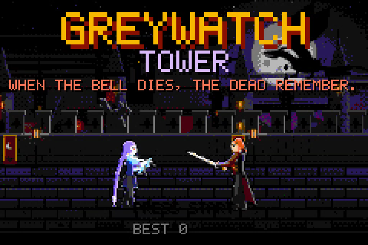
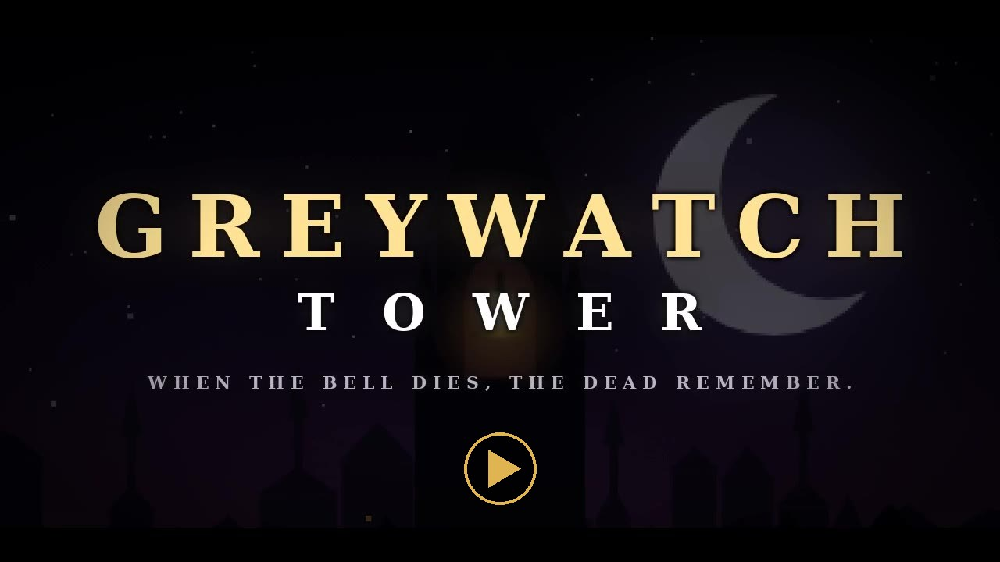
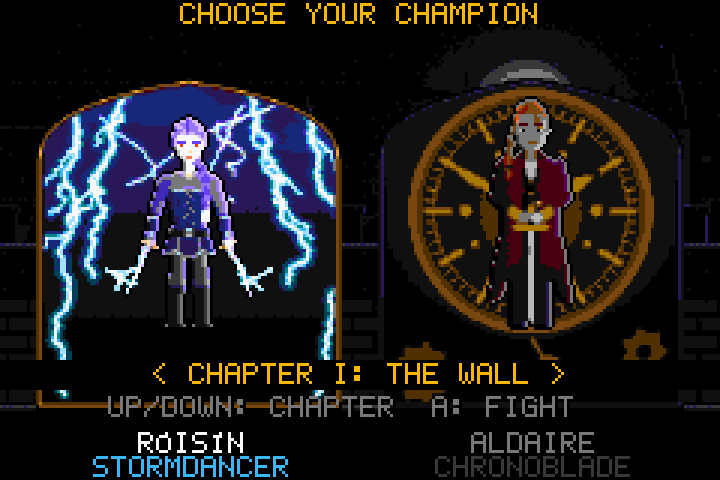
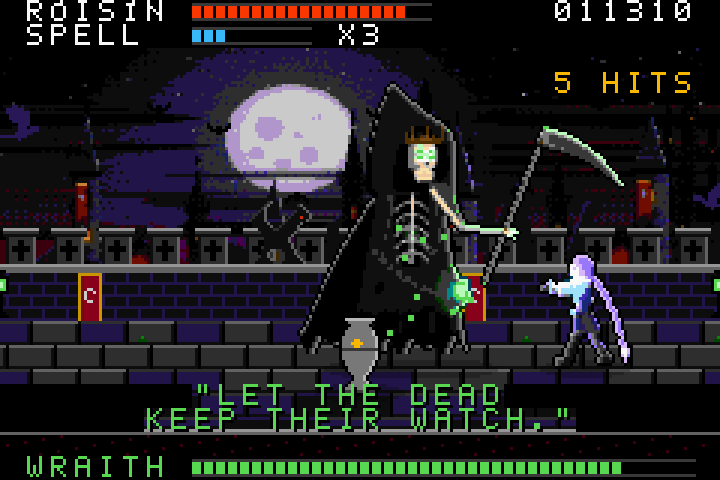
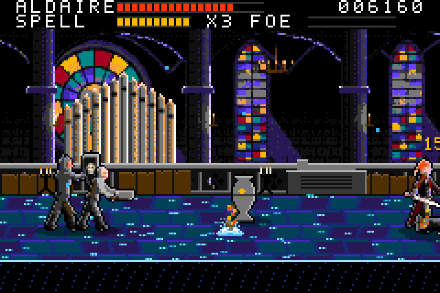
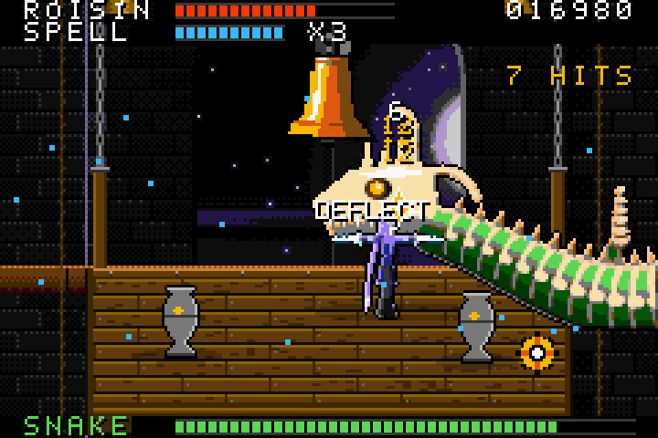
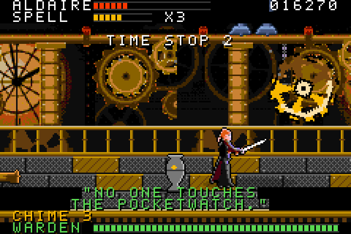
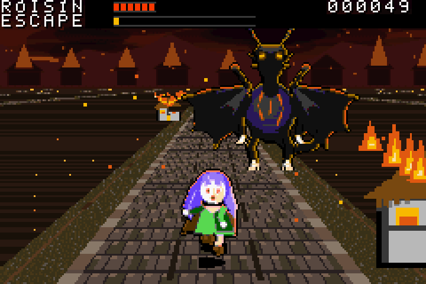
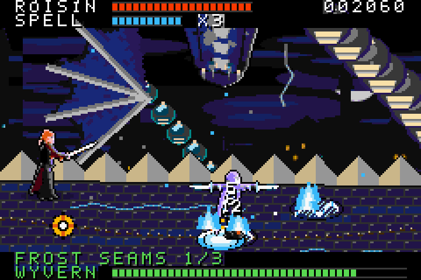
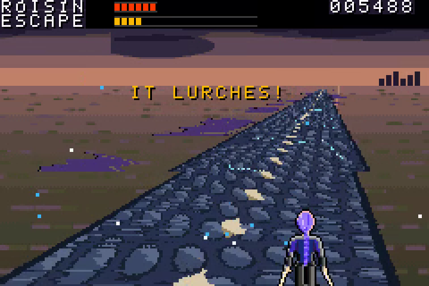

  

<h1 align="center">Greywatch Tower</h1>

<em>When the bell dies, the dead remember.</em>

  A gothic beat-'em-up for the Game Boy Advance. 
  <strong><a href="https://bezoon5.github.io/Greywatch-Tower---GBA-game/">▶ Play in your browser</a></strong>
  &nbsp;·&nbsp;
  <strong><a href="https://github.com/Bezoon5/Greywatch-Tower---GBA-game/raw/main/greywatch-tower.gba">⬇ Download the ROM</a></strong>

---

For a hundred years the great bell of Greywatch has tolled at midnight to keep the dead in their graves. Tonight a black dragon tears it down in a storm of fire, and the dead rise.

Two strangers hold the walls. **Róisín** is a storm-calling dancer with lightning daggers. **Aldaire** is the last clockmaker of a vanished guild, and he can stop time. Beneath the city, the bell has been holding back something far older than the dead.

Greywatch Tower is a brand-new game built for original GBA hardware. It plays on a real Game Boy Advance (with a flash cart), the Analogue Pocket, any good GBA emulator, or right here in your browser.

## Trailer

  

## Features

- **Seven chapters**, two flashbacks and three special stages, told through illustrated story pages between levels.
- **Two heroes** with their own moves: Róisín's Chain Lightning, Storm Dash and Thunderclap; Aldaire's Chrono Lunge, Time-Slip Roll and Stop Time.
- **Belt-scroller combat** with combos, jump attacks, running strikes and spell moves.
- **Boss fights** against a wraith, a drowned bishop, a bone serpent coiled round a bell, a king who blows out the lights, a clockwork giant, a black dragon and a wyvern bigger than the screen.
- **Pseudo-3D stages** drawn line by line on GBA hardware: a flight from a burning village, a bolt-thrower duel with the dragon, and a slide down the back of a falling wyvern.
- **An original soundtrack** of organ, choir, bells and storm.
- **Story Mode** and **Free Play**, a bestiary, and twelve hidden brass gears.

## Screenshots

| | |
|---|---|
|  |  |
|  |  |
|  |  |
|  |  |

## How to play

- **In your browser:** open the [web player](https://bezoon5.github.io/Greywatch-Tower---GBA-game/). It works on desktop and on phones (on-screen buttons appear on touch screens).
- **On an emulator:** download [`greywatch-tower.gba`](https://github.com/Bezoon5/Greywatch-Tower---GBA-game/raw/main/greywatch-tower.gba) and open it in mGBA, Delta (iOS), RetroArch or any GBA emulator.
- **On an Analogue Pocket:** copy the ROM to the GBA folder on the SD card (`/Assets/gba/common/`, where the GBA core also expects its BIOS file) and launch it from the GBA core.
- **On a real Game Boy Advance:** write the ROM to a flash cartridge. The game saves to battery-backed SRAM.

## Controls

| GBA button | In the web player (keyboard) | What it does |
|---|---|---|
| D-pad | Arrow keys | Move (tap twice to run) |
| A | Z | Jump |
| B | X | Attack; hold and release for a charged move |
| R | E | Dash / roll |
| L | Q | Spell (uses half the spell bar) |
| Start | Enter | Pause (moves list, bestiary, settings) |
| Select | V | Music on/off |

You can remap the keys, or use a gamepad, from the web player's control menu. The pause menu's **Moves** page lists every move for the current hero.

## Tips

- Your spell bar refills as you land hits, so stay aggressive.
- Light matters in the Ossuary: keep the braziers burning.
- Every playable stage hides one brass gear. Find all twelve for a different ending.
- There may be a code. You know the one.

## Credits

**Created by Bezoon.** All story, characters, art and music are original.

The web player uses [EmulatorJS](https://emulatorjs.org) (GPL-3.0) with the [mGBA](https://mgba.io) core (MPL-2.0). They are loaded from the EmulatorJS CDN when you open the page and are not part of this repository.

## Licence

© 2026 Bezoon. All rights reserved. You're welcome to play the game, share the link, share the unmodified ROM for free, and stream or post videos of it. See [LICENSE](LICENSE) for the details.
